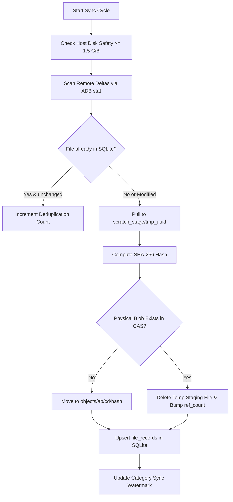

# Balo: Zalo Android Backup & CAS Synchronization Toolkit

A forensic-grade, non-root backup and data synchronization toolkit for **Zalo on Android** (Android 11–16 with Scoped Storage).

This repository provides three core tools designed to safely acquire, incrementally synchronize, and cryptographically verify Zalo media (chat pictures, voice memos, videos, attachments, and public media) without requiring root permissions on the target device:

1. [`export_zalo.sh`](export_zalo.sh) — Interactive Bash script for one-off bulk media extractions.
2. [`zalo_interval_sync.py`](zalo_interval_sync.py) — Continuous daemon and differential backup engine with Content-Addressable Storage (CAS) and SQLite relational tracking.
3. [`cas_integrity_scrub.py`](cas_integrity_scrub.py) — Cryptographic integrity verification auditor for physical CAS blobs.

---

## Table of Contents

- [Architecture Overview](#architecture-overview)
- [Prerequisites & System Setup](#prerequisites--system-setup)
- [Tool 1: Interactive Bulk Exporter (`export_zalo.sh`)](#tool-1-interactive-bulk-exporter-export_zalosh)
- [Tool 2: CAS Interval Sync Engine (`zalo_interval_sync.py`)](#tool-2-cas-interval-sync-engine-zalo_interval_syncpy)
  - [CLI Reference](#cli-reference)
  - [Manual Guide & Internal Architecture](#manual-guide--internal-architecture-zalo_interval_syncpy)
  - [Database Schema (SQLite WAL)](#database-schema-sqlite-wal)
- [Tool 3: CAS Cryptographic Auditor (`cas_integrity_scrub.py`)](#tool-3-cas-cryptographic-auditor-cas_integrity_scrubpy)
  - [CLI Reference](#cli-reference-1)
  - [Manual Guide & Verification Logic](#manual-guide--verification-logic-cas_integrity_scrubpy)
- [Tool 4: CAS Repository Reconstitution & Exporter (`restore_zalo_export.py`)](#tool-4-cas-repository-reconstitution--exporter-restore_zalo_exportpy)
- [Tool 5: Conversation & Thread Exporter (`export_zalo_conversations.py`)](#tool-5-conversation--thread-exporter-export_zalo_conversationspy)
- [Useful SQLite Queries for Backup Auditing](#useful-sqlite-queries-for-backup-auditing)
- [Troubleshooting & Safety Guardrails](#troubleshooting--safety-guardrails)

---

## Architecture Overview

On production Android builds, private internal sandbox storage (`/data/data/com.zing.zalo/`) is protected by Linux DAC and SELinux policies (`run-as` is disabled on release builds). However, Zalo stores virtually all primary received and transmitted media assets under the app-specific external storage directory:

```
/sdcard/Android/data/com.zing.zalo/files/zalo/
```

This path, along with public shared directories (`/sdcard/Download/Zalo/` and `/sdcard/Pictures/Zalo/`), is fully accessible to the unprivileged ADB shell (`uid=2000, shell`).

### Toolkit Comparison

| Feature / Goal | `export_zalo.sh` | `zalo_interval_sync.py` | `cas_integrity_scrub.py` |
| :--- | :--- | :--- | :--- |
| **Primary Use Case** | One-time snapshot / ad-hoc full backup | Continuous incremental sync / daemon | Integrity audit & bitrot detection |
| **Storage Model** | Flat folder hierarchy | Content-Addressable Storage (`objects/ab/cd/<sha256>`) | Reads existing CAS repository |
| **Deduplication** | No (duplicates across chats stored as-is) | Yes (SHA-256 deduplication across all chats) | N/A |
| **Database Tracking**| Text manifest (`export_manifest.txt`) | Relational SQLite (`zalo_backup.db` in WAL mode) | Reads SQLite `file_blobs` |
| **Host Safety Checks**| Pre-flight disk space display | Strict dynamic guardrail (< 1.5 GiB abort) | File read verification |
| **Execution Mode** | Interactive terminal prompt | One-shot (`--once`) or daemon loop (`--interval`) | Standalone batch verification |

---

## Prerequisites & System Setup

### 1. Android Device Configuration
- Enable **Developer Options** (tap *Build Number* 7 times in *Settings > About Phone*).
- Enable **USB Debugging** in *Developer Options*.
- Connect your device via USB to your workstation.
- When prompted on the phone, tap **Always allow from this computer** to authorize ADB.

### 2. Workstation Dependencies
- **ADB (`adb`)**: Android Platform Tools must be installed and available in `$PATH`.
  ```bash
  adb version
  adb devices
  ```
- **Python**: Python 3.8 or newer (standard library only; no external `pip` packages required).
  ```bash
  python3 --version
  ```
- **Host Disk Space**: Ensure the workstation destination volume has at least **1.5 GiB** of free space (enforced by safety guardrails).

---

## Tool 1: Interactive Bulk Exporter (`export_zalo.sh`)

[`export_zalo.sh`](export_zalo.sh) is designed for quick, human-attended extractions. It scans the connected device, calculates storage consumption per category, checks local host disk space, and prompts you to select an export profile.

### Quick Start

```bash
# Make script executable (first time only)
chmod +x export_zalo.sh

# Run with default output directory (./zalo_backup)
./export_zalo.sh

# Or specify a custom backup directory
./export_zalo.sh /Volumes/ExternalDrive/zalo_backup_20261011
```

### Export Profiles

When executed, the script presents an interactive menu:

1. **Option 1: Essential Media (`[Recommended]`, ~1 GB)**
   - Extracts: Chat Pictures, Chat Downloads/Attachments, Voice Memos, Public Downloads, Public Saved Pictures, and Shared Link Previews.
2. **Option 2: Complete Media (~6.5 GB)**
   - Includes everything in Option 1 plus Chat Videos and Call Audio Logs (`call_asr`).
3. **Option 3: Everything + Cache (~7 GB)**
   - Pulls the entire scoped directory plus image/video streaming caches (`/sdcard/Android/data/com.zing.zalo/cache/zalo`).
4. **Option 4: Custom selection**
   - Prompts interactive `y/n` confirmation for each category individually.

### Output Structure

The output directory contains structured subfolders and an extraction manifest:

```
zalo_backup/
├── chat_pictures/
├── chat_downloads/
├── chat_voice_memos/
├── public_downloads/
├── public_pictures/
├── chat_videos/              # (if selected)
├── export_manifest.txt       # Hardware info, duration, and disk usage
```

---

## Tool 2: CAS Interval Sync Engine (`zalo_interval_sync.py`)

[`zalo_interval_sync.py`](zalo_interval_sync.py) is a production-grade, background synchronization engine. It uses a **Content-Addressable Storage (CAS)** architecture to ensure identical media files shared across multiple groups or forwarded chats are stored only once on disk.

### CLI Reference

```bash
python3 zalo_interval_sync.py [OPTIONS]
```

| Flag | Type | Default | Description |
| :--- | :--- | :--- | :--- |
| `--workspace` | `string` | `./zalo_backup_repo` | Directory path where CAS blobs (`objects/`) and SQLite DB (`zalo_backup.db`) are stored. |
| `--interval` | `int` | `300` | Sync cycle interval in seconds when running as a continuous daemon. |
| `--once` | `flag` | `False` | Executes a single differential pass and exits immediately (ideal for cron or test runs). |
| `--serial` | `string` | `None` | Target specific ADB device serial when multiple Android devices are connected. |

#### Example Usage

```bash
# 1. Run a single sync pass in a custom workspace:
python3 zalo_interval_sync.py --once --workspace ./zalo_repo

# 2. Run as a background daemon syncing every 10 minutes (600 seconds):
python3 zalo_interval_sync.py --interval 600 --workspace ./zalo_repo

# 3. Target a specific ADB device when multiple phones are attached:
adb devices
python3 zalo_interval_sync.py --serial 1234567890ABCDEF --once --workspace ./zalo_repo
```

---

### Manual Guide & Internal Architecture (`zalo_interval_sync.py`)

The script is structured into modular components:



#### Key Components:

1. **`ZaloCASDatabase` (Database Manager)**
   - Manages SQLite connection with **WAL mode (`journal_mode = WAL`)**, foreign keys enabled, and timeout handling.
   - Handles watermark retrieval and updates per category (`sync_watermarks`).
   - Manages blob registration and file path record bindings with deduplication logic.

2. **`ZaloBackupEngine` (Sync Orchestrator)**
   - **`check_host_disk_safety()`**: Checks host filesystem free space using `shutil.disk_usage()`. If free space drops below **1.5 GiB** (`SAFE_MIN_DISK_BYTES = 1610612736`), raises `StorageSafetyError` and aborts to prevent host disk exhaustion.
   - **`scan_remote_deltas(category, lookback_sec)`**: Uses low-overhead remote shell execution (`find ... -exec stat -c '%s %Y %n' {} +`) to retrieve file sizes, modification timestamps, and paths without transferring file contents.
   - **Sliding-Window Watermark (`DEFAULT_SLIDING_WINDOW_SEC = 120`)**: Offsets the last sync timestamp backward by 2 minutes during each scan. This eliminates race conditions caused by asynchronous writes or device clock adjustments.
   - **`pull_and_ingest_file(...)`**:
     - Pulls remote file to a temporary staging path: `<workspace>/scratch_stage/tmp_<uuid>`.
     - Streams SHA-256 in 1 MiB chunks (`1048576` bytes).
     - Calculates a two-level sharded directory structure:
       ```
       <workspace>/objects/<sha256[0:2]>/<sha256[2:4]>/<sha256>
       ```
     - If the physical blob already exists, deletes the temporary staging file and increments `ref_count` in SQLite.
     - If new, atomically moves the staging file into the sharded CAS path.
     - Records device ID, original path, filename, extension, mtime, and link run ID in `file_records`.

3. **`run_daemon(...)` (Service Loop)**
   - Implements automated recovery:
     - On `StorageSafetyError`: Pauses execution for 300 seconds without crashing.
     - On `DeviceCommunicationError`: Pauses for 30 seconds to allow device reconnection.
     - Clean exit on `SIGINT` / `SIGTERM` (`Ctrl+C`).

---

### Database Schema (SQLite WAL)

The engine automatically initializes `zalo_backup.db` with four relational tables:

```sql
-- 1. Unique physical CAS files stored in objects/
CREATE TABLE file_blobs (
    sha256_hash         TEXT PRIMARY KEY,
    size_bytes          INTEGER NOT NULL,
    mime_type           TEXT NOT NULL DEFAULT 'application/octet-stream',
    storage_relpath     TEXT NOT NULL UNIQUE,
    first_seen_at       INTEGER NOT NULL,
    last_verified_at    INTEGER NOT NULL,
    ref_count           INTEGER NOT NULL DEFAULT 1,
    md5_checksum        TEXT
);

-- 2. Every file instance on the Android device (points to a blob)
CREATE TABLE file_records (
    record_id           INTEGER PRIMARY KEY AUTOINCREMENT,
    blob_hash           TEXT NOT NULL,
    original_path       TEXT NOT NULL,
    filename            TEXT NOT NULL,
    file_ext            TEXT,
    category            TEXT NOT NULL,
    source_device_id    TEXT NOT NULL,
    device_mtime        INTEGER NOT NULL,
    device_size         INTEGER NOT NULL,
    last_sync_run_id    TEXT NOT NULL,
    is_deleted          INTEGER NOT NULL DEFAULT 0,
    created_at          INTEGER NOT NULL,
    updated_at          INTEGER NOT NULL,
    FOREIGN KEY (blob_hash) REFERENCES file_blobs(sha256_hash),
    CONSTRAINT uq_device_path UNIQUE (source_device_id, original_path)
);

-- 3. Execution checkpoints for every backup run
CREATE TABLE backup_checkpoints (
    run_id              TEXT PRIMARY KEY,
    started_at          INTEGER NOT NULL,
    completed_at        INTEGER,
    trigger_type        TEXT NOT NULL,
    status              TEXT NOT NULL,
    scanned_count       INTEGER NOT NULL DEFAULT 0,
    new_blobs_count     INTEGER NOT NULL DEFAULT 0,
    deduplicated_count  INTEGER NOT NULL DEFAULT 0,
    bytes_transferred   INTEGER NOT NULL DEFAULT 0,
    error_message       TEXT
);

-- 4. High-watermark tracking per media category
CREATE TABLE sync_watermarks (
    category_or_dir     TEXT PRIMARY KEY,
    last_watermark_ts   INTEGER NOT NULL DEFAULT 0,
    last_mtime_epoch    INTEGER NOT NULL DEFAULT 0,
    last_sync_status    TEXT NOT NULL,
    items_synced_count  INTEGER NOT NULL DEFAULT 0,
    total_bytes_synced  INTEGER NOT NULL DEFAULT 0,
    updated_at          INTEGER NOT NULL
);
```

---

## Tool 3: CAS Cryptographic Auditor (`cas_integrity_scrub.py`)

[`cas_integrity_scrub.py`](cas_integrity_scrub.py) performs bitrot detection, file corruption checks, and cold-storage audits. It validates every registered blob in `zalo_backup.db` against its physical file on disk.

### CLI Reference

```bash
python3 cas_integrity_scrub.py <path_to_zalo_backup.db> <workspace_root>
```

| Argument | Description | Example |
| :--- | :--- | :--- |
| `<path_to_zalo_backup.db>` | Absolute or relative path to the SQLite backup database. | `./zalo_backup_repo/zalo_backup.db` |
| `<workspace_root>` | Workspace root containing the `objects/` directory. | `./zalo_backup_repo` |

#### Example Usage

```bash
python3 cas_integrity_scrub.py ./zalo_backup_repo/zalo_backup.db ./zalo_backup_repo
```

#### Exit Codes

- `0` — **All blobs verified successfully** (zero corruptions, zero missing files).
- `1` — **Failure detected** (one or more blobs corrupted or missing from disk).

---

### Manual Guide & Verification Logic (`cas_integrity_scrub.py`)

#### How Verification Works:

1. Opens the SQLite database in read mode.
2. Queries all registered records:
   ```sql
   SELECT sha256_hash, size_bytes, storage_relpath FROM file_blobs;
   ```
3. Resolves each `storage_relpath` relative to `<workspace_root>`.
4. **Presence check**: Verifies if the file exists on the filesystem. If missing, increments `missing` counter and logs `[MISSING]`.
5. **Cryptographic hashing**: Reads the physical file in **1 MiB chunks (`1048576` bytes)** to avoid memory spikes even on large multi-gigabyte video files.
6. **Hash comparison**: Compares computed SHA-256 digest with the database `sha256_hash`.
   - If mismatch: Logs `[CORRUPTED]` with expected and actual digests, increments `corruptions`.
   - If match: Increments `verified`.
7. Logs periodic progress every 1,000 files and outputs summary metrics:
   ```
   Integrity Scrub Completed: Verified=1420 | Corrupted=0 | Missing=0
   ```

---

## Tool 4: CAS Repository Reconstitution & Exporter (`restore_zalo_export.py`)

[`restore_zalo_export.py`](restore_zalo_export.py) recomposes the physical files stored in the CAS repository (`objects/`) back into their original filenames and Android folder structure using relational records in `zalo_backup.db`.

### CLI Reference

```bash
python3 restore_zalo_export.py [OPTIONS]
```

| Flag | Default | Description |
| :--- | :--- | :--- |
| `--db` | `./zalo_backup.db` | Path to the SQLite backup database. |
| `--workspace` | `.` | Workspace path containing the `objects/` directory. |
| `--dest` | `./reconstituted_zalo` | Target export folder where reconstituted files will be created. |
| `--category` | `None` | Optional filter (`picture`, `video`, `downloads`, `file_resource`, etc.). Restores all categories if omitted. |
| `--mode` | `hardlink` | Restoration strategy: `hardlink` (instant, 0 extra disk space), `copy` (duplicate byte-for-byte), or `symlink`. |

#### Example Usage

```bash
# 1. Reconstitute all downloaded document attachments into a clean folder (zero extra disk space):
python3 restore_zalo_export.py --category downloads --dest ./my_downloads

# 2. Reconstitute all chat documents (file_resource):
python3 restore_zalo_export.py --category file_resource --dest ./my_chat_docs

# 3. Export the entire backup hierarchy into a folder:
python3 restore_zalo_export.py --dest ./full_zalo_export
```

---

## Tool 5: Conversation & Thread Exporter (`export_zalo_conversations.py`)

[`export_zalo_conversations.py`](export_zalo_conversations.py) extracts, normalizes, and archives chat messages, threads, contacts, and group chats from decrypted Zalo SQLite databases (acquired via Zalo PC backup, rooted device, or forensic dump).

### CLI Reference

```bash
python3 export_zalo_conversations.py <path_to_zalo_database> [--output <directory>]
```

| Argument / Option | Default | Description |
| :--- | :--- | :--- |
| `<path_to_zalo_database>` | *Required* | Path to decrypted SQLite database (e.g., `databases/zalo` or PC backup DB). |
| `--output` | `./zalo_conversations_export` | Destination folder for exported archives and transcripts. |

### Exported Formats

1. **`conversations_archive.json`**: Full structured JSON backup containing contacts, groups, threads, message text, timestamps, and parsed attachment metadata.
2. **`messages.csv`**: Universal CSV spreadsheet containing message rows, senders, timestamps, and attachment summaries.
3. **`transcripts/<Thread_Name>_<ID>.md`**: Beautiful, human-readable Markdown chat transcripts formatted per conversation partner or group.

#### Example Usage

```bash
# Export from a local Zalo database:
python3 export_zalo_conversations.py ./zalo_forensics/databases/zalo --output ./exported_chats
```

---

## Useful SQLite Queries for Backup Auditing

You can query `zalo_backup.db` directly using the standard `sqlite3` CLI:

```bash
sqlite3 ./zalo_backup_repo/zalo_backup.db
```

### 1. Storage Space Saved by Deduplication
```sql
SELECT 
    COUNT(r.record_id) AS total_files_on_device,
    COUNT(DISTINCT b.sha256_hash) AS unique_physical_blobs,
    ROUND(SUM(r.device_size) / (1024.0 * 1024.0), 2) AS virtual_device_mb,
    ROUND(SUM(DISTINCT b.size_bytes) / (1024.0 * 1024.0), 2) AS actual_cas_mb,
    ROUND((SUM(r.device_size) - SUM(DISTINCT b.size_bytes)) / (1024.0 * 1024.0), 2) AS storage_saved_mb
FROM file_records r
JOIN file_blobs b ON r.blob_hash = b.sha256_hash;
```

### 2. Breakdown of Files by Category
```sql
SELECT 
    category,
    COUNT(*) AS total_files,
    ROUND(SUM(device_size) / (1024.0 * 1024.0), 2) AS size_mb
FROM file_records
GROUP BY category
ORDER BY size_mb DESC;
```

### 3. Recent Backup Checkpoints Status
```sql
SELECT 
    run_id,
    datetime(started_at, 'unixepoch', 'localtime') AS started,
    status,
    scanned_count,
    new_blobs_count,
    deduplicated_count,
    ROUND(bytes_transferred / (1024.0 * 1024.0), 2) AS transferred_mb
FROM backup_checkpoints
ORDER BY started_at DESC
LIMIT 10;
```

---

## Troubleshooting & Safety Guardrails

### 1. Device Not Found or Unauthorized
- **Symptom:** `Error: No authorized Android device found` or `ADB executable not found in system PATH`.
- **Solution:**
  1. Check device USB connection: `adb devices`
  2. If listed as `unauthorized`, unlock your phone and tap **Trust / Allow USB Debugging**.
  3. Restart the ADB daemon if unresponsive:
     ```bash
     adb kill-server
     adb start-server
     ```

### 2. Host Storage Safety Halt (`StorageSafetyError`)
- **Symptom:** Daemon halts with log message:
  ```
  SAFETY HALT: ABORT: Host free space is X.XX GiB, below the 1.50 GiB safety threshold!
  ```
- **Reason:** Both scripts enforce a minimum free space buffer of 1.5 GiB (`SAFE_MIN_DISK_BYTES`) to protect the host operating system from storage exhaustion.
- **Solution:** Free up disk space on your workstation volume. The daemon automatically checks every 300 seconds and resumes once space is above threshold.

### 3. Recovering from Interrupted Pulls
- If a backup process is interrupted (e.g. cable disconnected), temporary unhashed files in `<workspace>/scratch_stage/` can be safely deleted:
  ```bash
  rm -rf ./zalo_backup_repo/scratch_stage/*
  ```
- Re-run `zalo_interval_sync.py`. The sliding-window watermark ensures missed files are automatically detected and fetched on the subsequent cycle.
