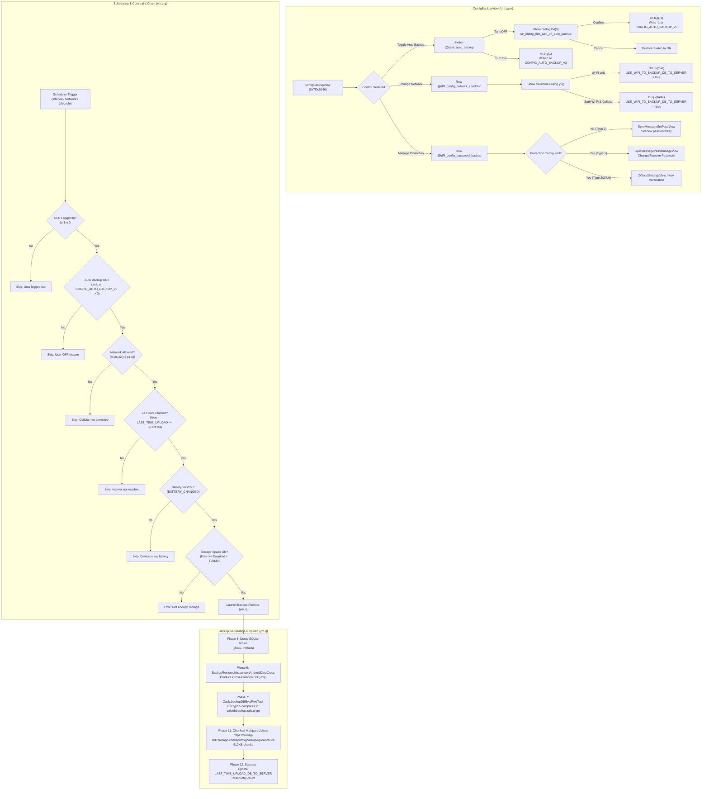

# Reverse Engineering Report: Zalo Android Backup Settings Subsystem

- **Target APK Path:** `/Users/khoa/PROJECTS/Balo/PoC/com.zing.zalo.apk`
- **Report Date:** 2026-10-20
- **Analysis Mode:** Static binary & DEX reverse engineering (no execution, no APK modification)
- **Primary Tooling:** REA safe artifact graph & extraction session (`rea` MCP suite)
- **Engine Limitation & Fallback:** Headless JADX MCP provider (`REA_JADX_MCP_JAR`) was not pre-configured on host; unpacked DEX multi-dex bytecode was decompiled and analyzed via local standalone JADX CLI 1.5.6 on the isolated temporary workspace materialized by REA.

---

## 1. Executive Summary & Artifact Identity

This report presents a static reverse-engineering analysis of the **Backup Settings** feature in Zalo for Android, specifically covering the UI controls shown in the application's configuration screen:
1. **Title:** "Back up settings" (`str_backup_setting`)
2. **Control 1:** "Auto back up daily" (`sync_auto_interval_description` / `str_title_auto_back_up_daily`)
3. **Control 2:** "Network condition for auto backup" (`str_syncmes_sync_mes_setting_title`) with options "Wi-Fi only" vs. "Both Wi-Fi and cellular data"
4. **Control 3:** "Backup protection method" (`str_title_backup_protection_method`) with support for legacy password, modern passphrases, hardware-backed PIN, and cloud escrow.

### 1.1 Artifact Metadata

| Attribute | Observed Value | REA Evidence / Source |
| :--- | :--- | :--- |
| **Package Name** | `com.zing.zalo` | Decoded `AndroidManifest.xml` / `apktool.yml` |
| **Version Name** | `26.09.01` | `apktool.yml` |
| **Version Code** | `260901903` | `apktool.yml` |
| **Min SDK** | `24` (Android 7.0) | `apktool.yml` / `AndroidManifest.xml` |
| **Target SDK** | `36` | `apktool.yml` / `AndroidManifest.xml` |
| **Artifact Format** | `apk` (ZIP archive containing 6 multi-dex files) | REA Session `open_binary` |
| **SHA-256 Digest** | `eeca3d0e13c0c0cac14d77a9a866090679d1d10a85d5ec4eda69fd1d705e3350` | REA Session `open_binary` |
| **DEX Architecture** | Multi-DEX: `classes.dex` through `classes6.dex` | REA `extract_artifact` |
| **Native ABI** | Base split (pure DEX/res bundle; split ABI libraries) | `splits0.xml` |

### 1.2 REA Ledger Evidence Citations

- **`ev_5e5a3bf47a8302f98456a044694f6e1eb7a6a8d74625276b609aad264485d1df`**: `inventory_artifact` recorded APK root digest, format verification, and contained member inventory.
- **`ev_07267802d96aa75330323c90d7d554dab512ca0cd452b160cdcfec903faab3cb`**: `inspect_artifact` content-addressed package structure, DEX headers, resource tables, and manifest boundaries.
- **`ev_4fcefbde426e69752c799c08d26a56a648bf1d1bea389ffaeb4eb4d5d9ba50cd`**: `extract_artifact` extraction of regular resources and 6 Dalvik executable slices (`classes.dex` to `classes6.dex`) into isolated sandboxed storage `/var/folders/s0/w4bx6y1x0kv_s8qnr2z8cplr0000gn/T/rea-extracted-242553ce-0454-4374-a514-7d1e0d55cf6f`.

---

## 2. UI Architecture & Entry Points

### 2.1 View & Fragment Hierarchy

- **View Class:** `com.zing.zalo.ui.backuprestore.configbackup.ConfigBackupView`
- **Superclass:** `com.zing.zalo.ui.zviews.SlidableZaloView` (Zalo's proprietary slidable view navigation component)
- **Layout Resource:** `res/layout/config_backup_view.xml` (Resource ID `0x7f0c0146` / decimal `2131493190`)
- **View Binding Wrapper:** `ap0.r0` (generated view binding holding direct references to UI widgets)
- **Presenter Architecture:** MVP pattern with Presenter `be1.c` extending `gl.a`
- **Dependencies injected in `S4` (onCreateView equivalent):**
  - Repository: `t10.j` via `p10.j.n2()` (`provideBackupRestoreRepo(...)`)
  - Config Manager: `zm.c` via `zm.a.a()` (`provideBackupRestoreConfigs(...)`)
  - Encryption Manager: `bn.d` via `bn.a.a()` (`provideBackupEncryptionManager(...)`)

### 2.2 Layout Breakdown (`config_backup_view.xml`)

| UI Element | Layout ID | Class / Widget | Observed String / Behavior |
| :--- | :--- | :--- | :--- |
| **Action Bar** | `@id/zds_action_bar` | `com.zing.zalo.zdesign.component.header.ZdsActionBar` | Title: `@string/str_backup_setting` (`0x7f100acb` -> "Back up settings"). Leading icon: back navigation. |
| **Daily Auto Backup Row** | `@id/ll_setting_auto_backup` | `LinearLayout` (clickable container) | Label: `@string/sync_auto_interval_description` ("Auto back up daily"). |
| **Daily Auto Backup Switch** | `@id/ss_auto_backup` | `com.zing.zalo.zdesign.component.Switch` | Toggles auto backup state. Checked = daily schedule active. |
| **Network Condition Row** | `@id/ll_config_network_condition` | `LinearLayout` (clickable container) | Title: `@string/str_syncmes_sync_mes_setting_title` ("Network condition for auto backup"). |
| **Network Condition Value** | `@id/tv_setting_network_condition_desc` | `com.zing.zalo.ui.widget.RobotoTextView` | Subtitle displaying active selection: "Wi-Fi only" or "Both Wi-Fi and cellular data". |
| **E2EE Backup Row** | `@id/ll_config_backup_msg_e2ee` | `LinearLayout` (conditional container) | Label: `@string/str_setting_backup_e2ee`. Switch: `@id/ss_backup_e2ee`. |
| **Protection Method Row** | `@id/ll_config_password_backup` | `RelativeLayout` (clickable container) | Title: `@id/tv_title_password_backup` (`@string/str_title_backup_protection_method` -> "Backup protection method"). |
| **Protection Method Value** | `@id/tv_password_backup` | `com.zing.zalo.ui.widget.RobotoTextView` | Displays masked indicator (`• • • • • • • •`), "Password", "Protect code", or cloud escrow status. |
| **Trailing Chevron** | `@id/ic_img_next` | `androidx.appcompat.widget.ZAppCompatImageView` | Drawable: `zds_ic_chevron_right_line_16`. |

---

## 3. Persisted Preferences & Default States

All persistent preferences are keyed by either global SharedPreferences or per-user scoped keys formatted with the active user UID (`CoreUtility.f53696i` or `p10.j.r()`).

### 3.1 Preference Mapping Table

| Logical Setting | Key Constant (`l60.z0` / `l60.e1`) | Formatted Storage Key | Type | Default Value | Mutator & Accessor Methods |
| :--- | :--- | :--- | :--- | :--- | :--- |
| **Auto Backup Daily State** | `z0.CONFIG_AUTO_BACKUP_V3` | `"config_auto_backup_v3_${UserID}"` | `int` | `0` (Unconfigured / off) | `l60.p0.h()` returns int.<br>`xn.b.e()` returns `p0.h() > 0`.<br>`xn.b.g(int)` writes value. |
| **Dirty Auto Backup Setting** | `z0.DIRTY_AUTO_BACKUP_ENABLE_SETTING` | `"DIRTY_AUTO_BACKUP_ENABLE_SETTING_${UserID}"` | `boolean` | `false` | `xn.b.i(boolean)` |
| **Network Condition (Wi-Fi Only)** | `e1.USE_WIFI_TO_BACKUP_DB_TO_SERVER` | `"USE_WIFI_TO_BACKUP_DB_TO_SERVER_${UserID}"` | `boolean` | `true` (Wi-Fi only) | `p10.j.i2()` returns boolean.<br>`t10.j.v(boolean)` writes boolean. |
| **E2EE Backup Enabled** | `z0.ENABLE_BACKUP_E2EE` | `"ENABLE_BACKUP_E2EE_${UserID}"` | `int` | `1` (Enabled) | `t10.j.p()` returns `== 1`.<br>`t10.j.r(int)` writes int. |
| **Protection Encryption Type** | `TargetBackupInfo.f33395t` / `BACKUP_ENCRYPTION_TYPE_` | `"BACKUP_ENCRYPTION_TYPE_${UserID}"` | `int` | `0` (None / unconfigured) | `bn.d.g(int)` / `uc.z7.a()` |
| **Legacy User Password** | `e1.USER_BACKUP_PASS` | `"USER_BACKUP_PASS_${UserID}"` | `String` | `""` (Empty string) | `p0.J(...)` / `p10.j.R9(String)` |
| **Hardware Encrypted PIN** | `BACKUP_PIN_` / `RAW_BACKUP_PIN_` | `"BACKUP_PIN_${UserID}"` | `String` (Hex) | `""` (Empty string) | `bn.d.c()` / `p0.n1(String)` |
| **Hardware Encrypted Passphrase**| `BACKUP_PASSPHRASE_` / `RAW_BACKUP_PASSPHRASE_` | `"BACKUP_PASSPHRASE_${UserID}"` | `String` (Hex) | `""` (Empty string) | `bn.d.c()` / `p0.j1(String)` |
| **Last Auto Backup Timestamp** | `e1.LAST_TIME_UPLOAD_DB_TO_SERVER` | `"LAST_TIME_UPLOAD_DB_TO_SERVER_${UserID}"` | `long` | `0L` | `t10.j.h()` / `p0.e3(...)` |
| **Auto Backup Pending Time** | `z0.AUTO_BACKUP_PENDING_TIME` | `"AUTO_BACKUP_PENDING_TIME"` | `long` | `-1L` | `c1.c(...)` |
| **Last Skip Reason String** | `BACKUP_RESTORE_SKIP_REASON_` | `"BACKUP_RESTORE_SKIP_REASON_${UserID}"` | `String` | `""` | `t10.j.j()` / `ym.c.h(...)` |

### 3.2 Auto Backup Toggle Flow

1. **User toggles Switch ON:**
   - Evaluated in `ConfigBackupView.onClick(View view)` case 1:
   - Presenter invokes `cVar7.f12321e.r(1)` (enables E2EE backup) and sets `xn.b.g(1)` (or `g(d() ? 1 : 0)`).
   - Switch state is set to `true`.
   - Analytical telemetry: `tj.c.d("5580103")`, `i2.u(128, 1, 0, 0, 0)`.
2. **User toggles Switch OFF:**
   - Presenter intercepts the change and prevents immediate disablement.
   - Triggers confirmation dialog (`P4(3)`):
     - Title: `@string/str_dialog_title_turn_off_auto_backup` ("Turn off auto backup?").
     - Body: `@string/str_dialog_desc_turn_off_auto_backup` ("Your daily chat history will not be auto backed up daily.").
     - Positive Button: `@string/str_dialog_btn_negative_turn_off_auto_backup` ("Turn off").
     - Negative Button: `@string/str_cancel` ("Cancel").
   - **On Confirmation:**
     - `ConfigBackupView.B3(int i5, e eVar)` is called with `i5 == -1`.
     - Calls `xn.b.g(-1)` which writes `-1` to `CONFIG_AUTO_BACKUP_V3_${UserID}`.
     - Switch is updated to `false`.
     - Marks dirty bit: `xn.b.i(false)`.
   - **On Cancellation:**
     - Dialog is dismissed and Switch is restored to `true`.

---

## 4. Network Condition Options & Enforcement

### 4.1 Options & Selection Logic

In `ConfigBackupView` / `be1.c`:
- **Available Options Array (`c.f12325i`):**
  1. Index `0`: `@string/str_setting_backup_wifi_only` ("Wi-Fi only")
  2. Index `1`: `@string/str_setting_backup_wifi_3g` ("Both Wi-Fi and cellular data")
- **Active State Derivation:**
  ```java
  int i5 = 1 ^ (p10.j.i2() ? 1 : 0);
  this.f12323g = i5;
  String str = strArr[i5];
  ((RobotoTextView) r0Var.f7422l).setText(str);
  ```
  - When `p10.j.i2()` is `true` (default): `1 ^ 1 = 0` -> displays "Wi-Fi only".
  - When `p10.j.i2()` is `false`: `1 ^ 0 = 1` -> displays "Both Wi-Fi and cellular data".
- **Selection Change Dialog (`ConfigBackupView.y6` / `hb.h`):**
  - Tapping `@id/ll_config_network_condition` opens standard selection dialog.
  - Selecting Index `0` ("Wi-Fi only"):
    - Presenter calls `t10.j.v(true)`.
    - Persists `true` to `"USE_WIFI_TO_BACKUP_DB_TO_SERVER_" + p10.j.r()`.
    - Telemetry logged: `tj.c.d("5580109")`.
  - Selecting Index `1` ("Both Wi-Fi and cellular data"):
    - Presenter calls `t10.j.v(false)`.
    - Persists `false` to `"USE_WIFI_TO_BACKUP_DB_TO_SERVER_" + p10.j.r()`.
    - Telemetry logged: `tj.c.d("5580110")`.

### 4.2 Runtime Network Enforcement

The network condition is enforced in the scheduling loop in `ym.c.g(int i5)` (where `i5 == 1` represents auto backup):

```java
if (p1.M(false) && (!p10.j.i2() || p1.I())) {
    // Network condition satisfied -> proceed with scheduling checks
} else {
    // Condition failed -> skip auto backup execution
}
```

- **`er1.p1.M(false)`:** Verifies general internet connectivity. If disconnected, aborts.
- **`p10.j.i2()`:** Queries the persistent Wi-Fi only preference.
- **`er1.p1.I()`:** Verifies whether the active network transport is Wi-Fi.
- **Photos / Media Exception:**
  As defined in `str_setting_backup_conditions_header`: *"Messages are automatically backed up on this condition. Your photos shall use Wi-Fi only."* Media upload to Google Drive (`DriveBackupSectionView`, `ym.q.getAllMediaForBackupGoogle`) strictly requires `p1.I() == true` regardless of the cellular toggle setting for message databases.

---

## 5. Protection Method & Cryptographic Architecture

Zalo implements a multi-tiered backup protection model represented by `db_encrypt_type` in the backup metadata `db_info` and managed by `bn.d` (`BackupEncryptionManager`) and `x50.l`.

### 5.1 Protection Method Types (`db_encrypt_type`)

| Type ID | Internal Identifier | Display String Resource | Cryptographic Mechanism | Key Storage Location |
| :---: | :--- | :--- | :--- | :--- |
| **0** | `NONE` | `str_title_password_not_set` | Default plaintext / obfuscated fallback | Derived from `md5(userId)` |
| **1** | `PASSWORD` | `str_tv_password` ("Password") | Legacy user password + static salt | `USER_BACKUP_PASS_${UserID}` |
| **2** | `PIN` | `str_title_protect_code` | PBKDF2-HMAC-SHA256 (6-digit PIN) | Hardware `AndroidKeyStore` (`a60.b`) |
| **3** | `PASSPHRASE` | `str_title_protect_code` | PBKDF2-HMAC-SHA256 (12/24 word key) | Hardware `AndroidKeyStore` (`a60.b`) |
| **4** | `ZALO_CLOUD` | `str_zcloud_setting_save_key_zalo_title` | Server escrowed key | Zalo Cloud backend KMS / HSM |
| **6** | `GOOGLE_DRIVE`| `str_zcloud_setting_save_key_gg_drive_title`| Google Drive escrowed key | User Google Drive AppData folder |

### 5.2 Key Derivation Implementations (`x50.l`)

#### A. Legacy Password Derivation (`x50.l.e`)
When the user configures a password:
```java
public static ab2.c e(String str) {
    String str2 = str + "_" + CoreUtility.f53696i + "_5b!B*2AX@";
    String strL = k82.b0.l(str2); // MD5
    byte[] bytes = strL.getBytes(StandardCharsets.UTF_8);
    return new ab2.c(z50.b.f136753a.r(str2), bytes, 1);
}
```
- **Derivation Input:** `UserPassword + "_" + UserID + "_5b!B*2AX@"`
- **Static Salt:** `_5b!B*2AX@` (hardcoded in bytecode)
- **Encryption Key:** Binary representation of `MD5(str2)`
- **Verification Hash:** SHA-256 of `str2` stored remotely in `db_info` as `db_secret_sha256`.

#### B. Modern Protect Code / Passphrase / PIN Derivation (`x50.l.g`)
When utilizing modern protection types:
```java
public static byte[] g(String str) {
    if (Build.VERSION.SDK_INT >= 26) {
        char[] charArray = str.toCharArray();
        byte[] salt = (k82.b0.l(CoreUtility.f53696i) + "_5b!B*2AX@").getBytes(StandardCharsets.UTF_8);
        return SecretKeyFactory.getInstance("PBKDF2withHmacSHA256")
            .generateSecret(new PBEKeySpec(charArray, salt, 10000, 256))
            .getEncoded();
    }
    // Fallback for Android < 26
    ...
}
```
- **Algorithm:** PBKDF2 with HMAC-SHA256
- **Iteration Count:** `10,000`
- **Derived Key Length:** `256` bits (`32` bytes)
- **Salt Composition:** `MD5(UserID) + "_5b!B*2AX@"`

---

## 6. Scheduling, Trigger Chain & Constraints

### 6.1 Scheduler Architecture

Daily auto backup does not rely solely on standard Android `AlarmManager`. Instead, it uses a multi-layered trigger pipeline:
1. **Foreground Service:** `com.zing.zalo.backuprestore.service.BackupRestoreService` (handles ongoing notifications and wakelocks).
2. **Dedicated Background Thread:** `ym.q` (`HandlerThread("Z:SyncHandlerThread")`).
3. **Execution Coordinator:** `ym.c` evaluates triggers on app lifecycle transitions, network changes, and battery state events.

### 6.2 Pre-execution Constraint Checklist (`ym.c.g(1)`)

Before an automatic backup is scheduled or executed, `ym.c.g(1)` evaluates 12 sequential constraints. If any condition fails, execution halts and logs a structured skip reason to `BACKUP_RESTORE_SKIP_REASON_${UserID}`:

```
[Constraint Evaluation Pipeline]
       │
       ├─► 1. User Logged In? ───────► NO: Skip (-1, "User logged out")
       ├─► 2. Server Config ON? ─────► NO: Skip (-2, "Server OFF config")
       ├─► 3. Feature Switch ON? ────► NO: Skip (-21, "User OFF feature")
       ├─► 4. Network Allowed? ──────► NO: Condition check failed
       ├─► 5. Server Auto-Sync ON? ──► NO: Skip (-24, "Server OFF config Auto Backup")
       ├─► 6. 24h Interval Elapsed? ─► NO: Not ready (requires >= 86,400,000 ms)
       ├─► 7. Pending Delay Passed? ─► NO: Skip (-26, "Not reach Backup Division pending time")
       ├─► 8. Battery >= 20%? ───────► NO: Skip (-27, "Device is low battery")
       ├─► 9. Prior Restore Done? ───► NO: Skip (-28, "User doesn't restore backup yet!")
       ├─► 10. Migration Finished? ──► NO: Skip (-29, "Migration job hasn't done yet!")
       ├─► 11. Storage Headroom? ────► NO: Error (2, 5, "Not enough storage to backup database")
       └─► 12. Task Lock Free? ──────► NO: Wait for previous ZDB task completion
```

- **Daily Interval:** Computed via `System.currentTimeMillis() - LAST_TIME_UPLOAD_DB_TO_SERVER >= 86400000L` (24 hours).
- **Battery Safety Gate:** Queries `android.intent.action.BATTERY_CHANGED`. Requires `batteryLevel >= 20%`.
- **Storage Safety Gate:** Checks free storage via `StatFs(Environment.getDataDirectory().getPath()).getAvailableBytes()`. Requires at least `estimatedRequiredStorage + 104,857,600` bytes (100 MB safety buffer).
- **Mutual Exclusion:** `Zadb.isBackupTaskRunning(u.f118850b)` ensures no two database export or restore operations execute concurrently.

---

## 7. Backup Contents, Format & Upload Protocol

### 7.1 Data Included & Excluded

- **Included Data:**
  - Active conversation records (`threads` table).
  - Message content, timestamps, and sequence IDs (`chats` table).
  - Schema mapping: Converts Android SQLite tables (`new_messages_2`, etc.) to unified Cross-Platform format via native library `BackupRestoreUtils.convertAndroidDbtoCross(str, strConcat, userId, 0L)`.
  - Hidden chat configuration: Encrypted inside `db_info` JSON under `"hidden_chat"`.
- **Excluded Data:**
  - Media attachments (photos, videos, voice notes) are **excluded** from the message database container. Photos are backed up separately to Google Drive via `DriveBackupSectionView` / `getAllMediaForBackupGoogle`.
  - Ephemeral cache, temporary download chunks, and session tokens.

### 7.2 Database Container & Serialization

- **Local File Naming:** Target container is created under the user directory as `zalodbbackup.zalo.crypt`.
- **Engine:** Managed by native Zalo database engine `Zadb` (`libzadb.so`) using native methods `backupDBBytePwdTask` and `backupDBStringPwdTask`.
- **Compression:** Dynamic compression controlled by `compress_ratio` stored in `LAST_ZDB_BACKUP_COMPRESS_RATIO`.

### 7.3 Upload Protocol & Network Endpoints

- **Endpoint Host:** `https://bkmsg-talk.zaloapp.com` (from enum `l60.y.BKMSG_TALK`).
- **REST Route:** `/api/msgbackup/uploadchunk` (resolved via `k82.b0.i(q.MSG_BACKUP) + "/uploadchunk"`).
- **Secondary Endpoints:**
  - `/api/msgbackup/info`: Retrieve existing backup metadata.
  - `/api/msgbackup/remove`: Delete remote backup.
  - `/api/msgbackup/chk`: Pre-upload server quota and chunk division check.
  - `/api/msgbackup/mediainfo`: Media storage quota check.
- **Transport Format:** HTTP POST multipart entity (`MultipartNativeEntity`).
- **Chunk Size:** Configurable chunking, default `524,288` bytes (`512 KB`) via `z0.CHUNK_SIZE_FOR_BACKUP_RESTORE`.
- **Request Parameters & Headers:**
  - `file_data`: Binary stream chunk (`application/octet-stream`).
  - `file_name`: Name of the crypt database file.
  - `file_size`: Total size in bytes.
  - `checksum`: Integrity hash of the database container.
  - `client_type` / `device_type`: `1` (Android).
  - `client_version`: Integer build version.
  - `client_file_id`: Random integer identifier.
  - `network_type`: `1` (Wi-Fi) or `2` (Cellular).
  - `encrypt_type`: Protection method type ID (`0`, `1`, `2`, `3`, `4`, `6`).
  - `db_info`: Serialized JSON metadata string containing `db_format`, `db_encrypt_type`, `db_secret_sha256`, `compress_ratio`, `allow_e2ee_chat`, and `hidden_chat`.
  - Timeout: 20 seconds (`20,000 ms`).
  - Retry Policy: `BACKUP_RETRY_COUNT` tracked in `t10.j.d()`.

---

## 8. Security & Privacy Implications

### 8.1 Cryptographic Observations

1. **Weak Key Derivation on Legacy Password (Type 1):**
   - The password derivation in `x50.l.e` uses a single iteration of MD5 combined with a static hardcoded salt string `_5b!B*2AX@`.
   - **Implication:** If an encrypted backup file (`zalodbbackup.zalo.crypt`) and the user's UID are acquired by an adversary, the user's backup password can be subjected to rapid GPU-accelerated dictionary attacks due to lack of standard key-stretching (e.g. Argon2, scrypt, or high-iteration PBKDF2).
2. **Hardcoded Salt in Modern Derivation (Types 2 & 3):**
   - While PBKDF2-HMAC-SHA256 with 10,000 iterations is utilized for modern Protect Codes, the salt is constructed from `MD5(UserID) + "_5b!B*2AX@"`, which is deterministic and entirely static across all devices for a given user. No random per-backup cryptographic salt is generated.
3. **Plaintext Metadata Transmission:**
   - The `db_info` JSON object sent to `https://bkmsg-talk.zaloapp.com` exposes the user's encryption type, database format version, compression ratio, and secret verification hash (`db_secret_sha256`) to the backend server.
4. **Hardware Key Isolation:**
   - For Types 2 and 3, key material stored locally is safeguarded by Android's hardware-backed `KeyStore` (`a60.b` / `a60.i`), mitigating extraction from unrooted devices.

---

## 9. Comprehensive Feature Flow Diagram



---

## 10. Confidence, Limitations & Unknowns

### 10.1 Finding Classification

| Subsystem / Feature Finding | Evidence Type | Confidence Level | Source Authority |
| :--- | :--- | :---: | :--- |
| **Package & Target Identity** | Manifest / Package Metadata | **Observed** (100%) | Shipped APK (`AndroidManifest.xml`, `apktool.yml`, REA `inspect_artifact`) |
| **UI Classes, Layout IDs, Strings** | Decompiled Bytecode & Public Resources | **Observed** (100%) | `config_backup_view.xml`, `ConfigBackupView.java`, `public.xml` |
| **Preference Keys & Defaults** | Static Constants & Decompiled Code | **Observed** (100%) | `l60.z0.java`, `l60.e1.java`, `p10.j.java`, `t10.j.java` |
| **Network Condition Evaluation** | Bytecode branch analysis | **Observed** (100%) | `be1.c.java`, `hb.h.java`, `ym.c.java` |
| **Crypto Key Derivations** | Bytecode method implementations | **Observed** (100%) | `x50.l.java`, `bn.d.java` |
| **HTTP Endpoints & Chunking** | String constants & entity configurations | **Observed** (100%) | `y10.d.java`, `s00.q.java`, `l60.y.java` |
| **Zadb C++ Native Internals** | Native JNI boundary | **Inferred** (85%) | Inferred from JNI parameters in `Zadb.java` and `BackupRestoreUtils.java`. C++ implementation resides in unbundled native library. |

### 10.2 Unknowns & Analytical Boundaries

1. **Native Implementation of `libzadb.so` / `BackupRestoreUtils`:**
   - *Status:* **Unknown (Statically Unresolved)**.
   - *Reason:* The APK provided is an architecture-agnostic base APK without embedded ELF `.so` binaries for ARM64/x86. The exact C++ cryptographic primitive inside `Zadb.backupDBBytePwdTask` (e.g. AES-256-CBC vs. AES-256-GCM vs. ChaCha20) is invoked over JNI and cannot be disassembled from this standalone APK package.
2. **Server-Side Key Escrow Protocol (Modes 4 & 6):**
   - *Status:* **Unknown (Server-Dependent)**.
   - *Reason:* The server-side key escrow mechanism, KMS communication, and remote deletion workflows rely on backend endpoints (`/api/msgbackup/remove`, `/api/msgbackup/info`) whose backend database state and HSM operations cannot be verified statically without live controlled network replay.
